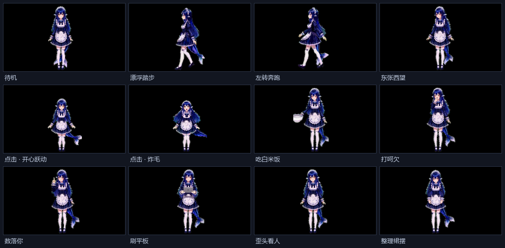

# 雌小鬼肥鱼桌宠素材包 · bluewhale_tv

一套给 **dsh-pet / dsh-pet-indesktop（WebM 版）** 用的桌宠角色素材：**47 段 640×360 透明动画**，丢进 `characters/` 就能换掉默认的 `shenshen`。

> 角色参考了社区「大肥鱼 / 鲸鱼娘」的人物设计语言，但为独立角色，不是同一个人物。
> 素材仍按来源惯例以 CC BY-NC-SA 4.0 发布并保留完整署名，详见 [ASSET_LICENSE.md](ASSET_LICENSE.md)。



> 截图取自各段动画的第 1.2 秒。桌面上的实际大小由 `scale` 决定，默认约 0.7 倍。

---

## 里面有什么

| 路径 | 内容 |
|---|---|
| `characters/bluewhale_tv/` | 角色本体：`videos/` 七类动画 + 三个配置文件 |
| `characters/bluewhale_tv/manifest.json` | `body_box` / `head_box`，点击与摸头的命中区（640×360 像素坐标） |
| `characters/bluewhale_tv/move_strides.json` | 移动动画每圈的地面位移，防止「跑步像滑冰」 |
| `characters/bluewhale_tv/text_clips.json` | 含文字的片段不做水平镜像（本角色为空） |
| `install.ps1` | Windows 一键安装 / 卸载（自动定位安装目录、先备份） |
| `tools/check_pack.py` | 素材自检：分辨率 / 帧率 / 编码 / alpha 平面 |
| `preview/overview.png` | 上面那张总览图 |

### 47 段动画

| 分类 | 段数 | 说明 |
|---|---|---|
| `idle/` | 6 | 待机循环，10–30 秒不等，按权重轮播 |
| `random/` | 29 | 随机小动作：吃白米饭、打呵欠、数落你、刷平板、盘腿打游戏、整理裙摆…… |
| `click/` | 8 | 点击回应：开心跃动、害羞惊讶、傲娇生气、炸毛、被按墙上、挠痒、吃白饭、头发散乱 |
| `move/` | 2 | 漂浮踏步、左转奔跑（带 stride 标定） |
| `turn/` | 1 | 东张西望 |
| `drag/` | 1 | 被鼠标拖拽悬空反馈 |
| `events/` | 0 | **空**，见「已知问题」 |

---

## 安装

### 前提

- 已装 **dsh-pet-indesktop** 的 WebM 版（`dsh-pet-standalone-webm` / `dsh-pet-standalone-webm-chat`），
  在 Windows 上实测版本 **v4.2.1**。
- 装的是 Chat 版还是无 Chat 版都行，两者共用同一套角色目录格式。

### 方式一：脚本（Windows，推荐）

```powershell
# 先把桌宠退出（托盘图标 → 退出），再执行：
powershell -ExecutionPolicy Bypass -File .\install.ps1

# 只看它打算干什么，不动文件：
powershell -ExecutionPolicy Bypass -File .\install.ps1 -DryRun

# 装在非默认目录：
powershell -ExecutionPolicy Bypass -File .\install.ps1 -InstallDir "D:\dsh-pet"

# 卸载（把旧角色还原回来）：
powershell -ExecutionPolicy Bypass -File .\install.ps1 -Uninstall
```

脚本会：定位安装目录 → 把原来的 `bluewhale_tv`（如果存在）整体挪到
`_internal\assets\_character-backups\bluewhale_tv-<时间戳>\` → 复制本包的角色目录 → 打印结果。
不需要管理员权限。备份特意放在 `characters\` 外面，免得被程序当成一个角色扫进菜单。

### 方式二：手动复制

1. 退出桌宠。
2. 找到安装目录，默认是：

   ```
   %LOCALAPPDATA%\Programs\dsh-pet-standalone-webm-chat\
   ```

   绿色版就是你解压出来的那个文件夹。
3. 把本包的 `characters\bluewhale_tv` 整个复制到：

   ```
   <安装目录>\_internal\assets\characters\bluewhale_tv
   ```

   最终应该是 `...\characters\bluewhale_tv\videos\idle\待机_1x.webm` 这样的层级。
4. 启动桌宠 → **右键桌宠 → 角色 → bluewhale_tv**。
   如果菜单里没看到，重启一次桌宠（部分版本只在启动时扫描素材目录）。
5. 大小不合适就调 `scale`（右键 → 桌宠设置）。

### 换掉而不是新增

想让角色 ID 还叫 `shenshen`、直接覆盖默认角色，也是把同名目录一盖就行；
但更推荐保留 `bluewhale_tv` 这个 ID，方便随时切回去。

### 回滚

安装脚本已经备份了旧目录，`-Uninstall` 会自动还原。
手动装的话，把自己覆盖前的 `bluewhale_tv` 拷回去即可 —— 本包不会碰其它角色。

---

## 素材规格

想自己做片段或者二次剪辑，照这个来：

| 项 | 值 |
|---|---|
| 容器 / 编码 | WebM / **VP9 Profile 0**（`-c:v libvpx-vp9`） |
| 像素格式 | `yuva420p`（**alpha_mode=1**，带透明平面） |
| 分辨率 | **640×360**，SAR 1:1 |
| 帧率 | **24 fps** 恒定 |
| 声音 | 无（`-an`） |
| 时长 | 待机 10–30 s；动作 5–75 s；长片段会被完整播完 |
| 命名 | 文件名就是菜单里显示的名字，**可以用中文** |

> 关于 alpha：这一版所有片段都带独立 alpha 平面（实测单帧约 90% 像素完全透明），
> 不需要靠黑底键出。用 `ffmpeg -i` 看流信息时，native VP9 解码器会把它显示成 `yuv420p`
> 并丢掉透明平面 —— 那是解码器的事，不是文件没有 alpha。要验就得用
> `-c:v libvpx-vp9 -pix_fmt rgba` 解一帧看 alpha 通道。

自检：

```bash
python tools/check_pack.py characters/bluewhale_tv/videos
```

---

## 自己加动作

链路是：**AI 生成绿幕视频 → 抠绿 → 裁切贴黑（或直接保留 alpha）→ 640×360 / 24fps / VP9-alpha**。

几个必须踩准的点：

1. **人物包围盒要稳定**。同一角色的所有片段，头顶到脚底的高度和底边 y 要一致，
   否则切换动作时会突然变大变小。本包实测：人物约 **334 px 高**，头顶 y≈18、脚底 y≈352
   （640×360 画面），横向 237–373；`body_box` 留了更宽的边，是给尾巴甩动用。
2. **首尾姿态尽量对齐**，循环才不跳。对不齐的可以做乒乓（正放+倒放），代价是时长翻倍。
3. **移动类要标 stride**：`move_strides.json` 里记「一圈动画地面实际走多少像素」，
   换角色必须重新量，否则会滑步。
4. 文件名直接决定显示名，改名前想清楚；改完同步改 `move_strides.json` 的键名。
5. 塞进 `characters/` 后重启桌宠。加载时程序会把长待机片段重写成自己的 `.ours` 版本、
   顺手改掉文件大小 —— 这是正常行为，别拿文件大小判断装没装进去。

---

## 已知问题

- **`events/` 是空的**：余额六档 / 工作状态那几段动画没做。这一版只会播其它分类，
  不会崩，但余额变化时没有专属表演。想补就按 `events/` 放 6 段，名字参考上游默认角色。
- **`turn/` 只有 1 段**，「转身」方向的选择余地很小。
- **有两处内容重复**：`idle/待机_4x.webm` 与 `random/平板.webm` 一模一样；
  `random/转身一圈.webm` 与 `turn/东张西望.webm` 一模一样。不占多少地方，介意就删一份。
- **`random/打游戏2.webm`（43.8 s）和 `打游戏3.webm`（74.8 s）很长**，随机抽到会长时间占屏。
  想要短版就删掉，或者只留一个。
- **循环接缝没有逐段量化**。走、跑、打游戏这几段做过接缝处理（帧差与普通相邻帧同量级），
  其余长片段首尾可能有轻微跳变。
- **AI 生成的固有瑕疵**：个别帧手指、道具边缘会糊，长片段里姿态会有小幅漂移。
- 角色形象参考了社区「大肥鱼 / 鲸鱼娘」的人物设计语言，属独立角色；为避免争议仍按
  CC BY-NC-SA 4.0 发布并保留署名，**请勿商用**，详见 [ASSET_LICENSE.md](ASSET_LICENSE.md)。

---

## 许可与署名

| 对象 | 许可 |
|---|---|
| `characters/` 下的全部动画与配置 | **CC BY-NC-SA 4.0**（署名 · 非商业 · 相同方式共享） |
| `install.ps1`、`tools/` 下的脚本 | MIT |
| 桌宠运行时本身 | 不属于本仓库，见上游 |

**二次发布必须保留署名**：

- 桌宠运行时：[`PC2005-cloud/dsh-pet`](https://github.com/PC2005-cloud/dsh-pet)（MIT）、
  [`MerZlin/dsh-pet-indesktop`](https://github.com/MerZlin/dsh-pet-indesktop)（MIT）
- 形象原型「溟月」：B 站 [@上善无形](https://space.bilibili.com/4456176)（设计参考与致敬）
- DeepSeek 版女仆鲸鱼娘形象设计：B 站 [@ZipZipPipe](https://space.bilibili.com/4168597)（设计参考与致敬）
- 本套动画：独立创作，AI 视频生成 + 抠像 / 裁切 / 转码，见 `CHANGELOG.md`

商业用途（含付费打包、会员专享、随硬件/服务搭售）一律不行。要商用请先拿到相关形象权利人的书面授权。

---

## English

A 47-clip animated character pack for [dsh-pet-indesktop](https://github.com/MerZlin/dsh-pet-indesktop) (WebM build): 640×360, 24 fps, VP9 with alpha. Drop `characters/bluewhale_tv` into `<install dir>\_internal\assets\characters\`, restart the pet, pick the character from the right-click menu. Windows users can run `install.ps1` (backs up the previous copy; `-Uninstall` restores it).

Assets are licensed **CC BY-NC-SA 4.0** — attribution required, **no commercial use**, derivatives under the same license. Scripts are MIT.
